# CAN 2.0B Protocol Controller — RTL · UVM · FPGA · RTL-to-GDS · FreeRTOS

A from-scratch **CAN 2.0A/2.0B controller IP** with an APB3 register interface. It is taken through the full flow of a silicon project:

- Verilog RTL design
- directed and **UVM** verification
- a Python golden model
- FPGA implementation on Artix-7
- **RTL-to-GDS** on SkyWater sky130 with OpenLane
- a **FreeRTOS driver** validated against the real RTL through Verilator HW/SW co-simulation


---

## Highlights

| Area | Result |
|---|---|
| RTL | 7 synthesizable modules, **0 lint warnings** (Verilator `-Wall`, Icarus `-Wall`) |
| Directed tests | 16 tests, **623/623 self-checks pass**; 3 nodes on 3 *different* clocks (50 MHz ±0.5 %) |
| Golden model | Independent Python encoder/decoder: **61 frames bit-exact** against the RTL bus traffic |
| UVM 1.2 (Vivado xsim) | 7 tests pass, 0 UVM errors, 0 SVA failures, 0 scoreboard mismatches, **100 % functional coverage** |
| FPGA (xc7a35t, Basys-3) | IP: 1131 LUT / 492 FF / 0 BRAM, **Fmax ≈ 119 MHz**; 2-node demo meets timing at 100 MHz, bitstream built |
| ASIC (sky130A, OpenLane) | **0.158 mm²**, +8.38 ns setup slack at 50 MHz (≥ +4.90 ns all corners), **9.94 mW**, **DRC 0 · LVS clean · antenna 0** |
| Firmware | FreeRTOS driver + 3-ECU application on the real RTL: 752 frames, **0 lost / 0 duplicated** through an injected EMI burst |

---

## Features

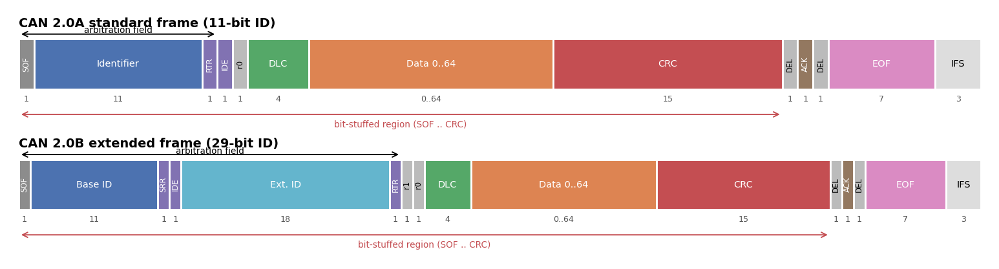

**Protocol (ISO 11898-1 classic CAN)**
- Standard (11-bit) and extended (29-bit) identifiers; data and remote frames; DLC 0–15 (more than 8 is treated as 8 bytes)
- Bit stuffing/destuffing and serial CRC-15 (polynomial 0x4599)
- Non-destructive bit-wise arbitration and in-frame ACK
- All 5 error types: bit, stuff, CRC, form, ACK
- Active and passive error flags, overload frames, suspend transmission
- Fault confinement:
  - TEC/REC counters
  - error-warning at 96, error-passive above 127, bus-off above 255
  - automatic bus-off recovery after 128 × 11 recessive bits
- Bit timing logic:
  - programmable prescaler and TSEG1/TSEG2/SJW
  - hard synchronisation on start-of-frame
  - re-synchronisation limited by SJW
- Bus integration (11 recessive bits) after leaving reset mode

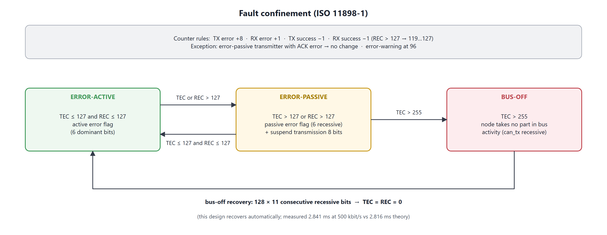

**Controller**
- APB3 slave, zero wait states, 10 interrupt sources (write-1-to-clear)
- TX buffer with automatic retransmission, single-shot mode and abort
- Acceptance filter (code/mask over `{IDE, RTR, ID[28:0]}`)
- 4-frame RX FIFO with overrun detection
- Listen-only (bus monitor) and internal loopback (self-test) modes
- Error-code capture (type, direction, FSM state) and the bit position where arbitration was lost
- Single clock domain; asynchronous `can_rx` input through a 2-FF synchroniser

---

## Architecture

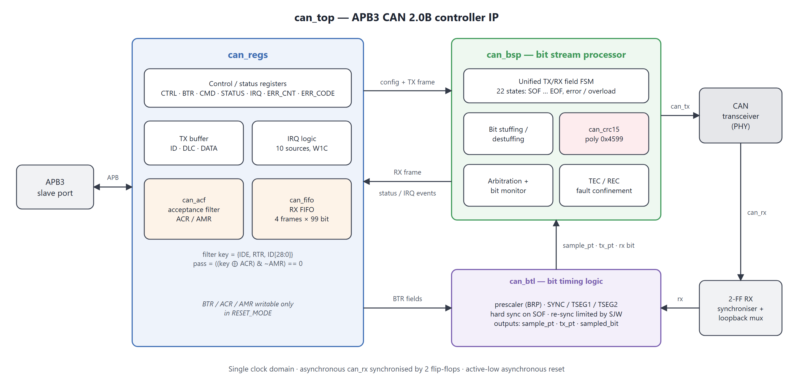

**Design idea: a unified transceiver FSM.** The node always decodes the bit it samples from the bus, including its own bits.

At each sample point, the transmitter computes the bit to drive in the *next* bit time. That bit comes from one of three places:
- a stuff bit, when stuffing is due
- the CRC register, during the CRC field
- the precomputed frame vector, everywhere else

Losing arbitration simply clears `tx_active`, and the same FSM carries on as a receiver of the winning frame. Bit monitoring, ACK checking, stuffing and CRC all share one bit pipeline.

| Module | Description |
|---|---|
| `can_top` | Integration, RX synchroniser, loopback/silent-mode muxing |
| `can_regs` | APB3 register file, TX buffer, IRQ logic, write protection outside reset mode |
| `can_bsp` | 22-state frame FSM, stuffing, CRC, arbitration, errors, TEC/REC, bus-off |
| `can_btl` | Prescaler, SYNC/TSEG1/TSEG2 quanta counter, hard sync, SJW-limited re-sync |
| `can_crc15` | Combinational one-bit CRC-15 step |
| `can_acf` | Acceptance filter: `pass = ((key ^ ACR) & ~AMR) == 0` |
| `can_fifo` | Synchronous first-word-fall-through RX FIFO |

<details>
<summary><b>Structural schematic of <code>can_top</code></b> (every inter-block bus named)</summary>

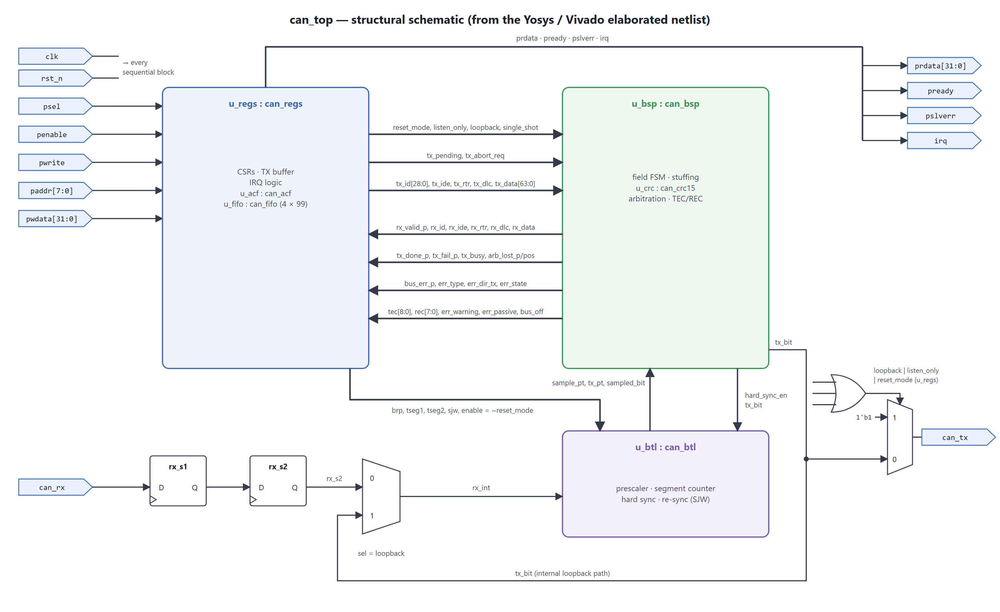
</details>

<details>
<summary><b>CRC-15 LFSR</b> (x¹⁵ + x¹⁴ + x¹⁰ + x⁸ + x⁷ + x⁴ + x³ + 1)</summary>

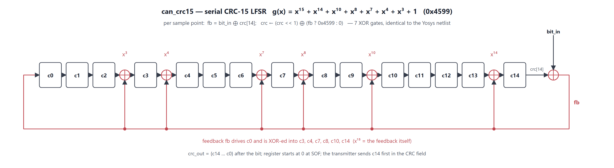
</details>

### Register map

| Offset | Register | Description |
|---|---|---|
| `0x00` | CTRL | RESET_MODE (1 after reset), LISTEN_ONLY, LOOPBACK, SINGLE_SHOT |
| `0x04` | BTR | BRP[9:0], TSEG1−1[15:12], TSEG2−1[18:16], SJW−1[21:20] (writable in reset mode only) |
| `0x08` | CMD | TX_REQ, ABORT_TX, RELEASE_RX, CLR_OVERRUN |
| `0x0C` | STATUS | RX_AVAIL, OVERRUN, TX_BUF_FREE, TX_COMPLETE, RX/TX_BUSY, ERR_WARN, ERR_PASSIVE, BUS_OFF, FIFO count, FSM state |
| `0x10` / `0x14` | IRQ_STAT / IRQ_EN | RX, TX_DONE, ERR_WARN, ERR_PASSIVE, BUS_OFF, ARB_LOST, BUS_ERR, OVERRUN, TX_FAIL, BUS_RECOVERED |
| `0x18` | ERR_CNT | TEC[8:0], REC[23:16] |
| `0x1C` | ERR_CODE | error type, direction, FSM state, arbitration-lost bit position |
| `0x20` / `0x24` | ACR / AMR | acceptance code / mask |
| `0x30`–`0x3C` | TX_ID, TX_DLC, TX_DATA0/1 | transmit buffer (byte 0 in `[7:0]`) |
| `0x40`–`0x4C` | RX_ID, RX_DLC, RX_DATA0/1 | head of the RX FIFO |
| `0x50` | VERSION | `0xCA20_B100` |

**Bit timing:**

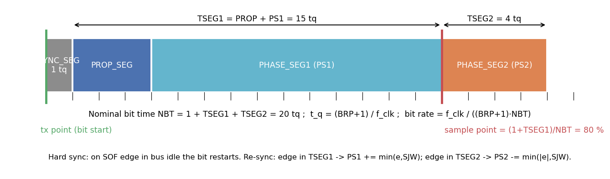

```
t_q = (BRP + 1) / f_clk
NBT = 1 + TSEG1 + TSEG2   (in t_q)
bit rate = f_clk / ((BRP + 1) · NBT)
sample point = (1 + TSEG1) / NBT
```

Example: at 50 MHz, BRP+1 = 5 and NBT = 1+15+4 = 20 give **500 kbit/s** with an **80 %** sample point. The RTL simulation measured 2000.0 ns per bit and an 80.0 % sample point.

---

## Repository structure

```
01_rtl/              CAN controller RTL (can_top, can_regs, can_bsp, can_btl, can_crc15, can_acf, can_fifo)
docs/images/         figures and screenshots used in this README
02_lint/             Verilator / Icarus lint script, Yosys statistics and schematics
03_tb_directed/      Icarus self-checking testbench, regression + oscillator-tolerance sweep
04_uvm/              UVM 1.2 environment (tb/) and Vivado xsim regression script
05_golden_model/     Python CAN golden model, bit-stream cross-check, waveform plots, theory checks
06_fpga_vivado/      Basys-3 demo top, constraints, Vivado batch build script
07_asic_openlane/    OpenLane config, flow script, KLayout render scripts
08_freertos_cosim/   CAN driver, FreeRTOS ECU application, Verilator harness, Makefile
scripts/             helper scripts
```

---

## Verification

### Directed testbench (Icarus Verilog)
Three controllers share a wired-AND bus with 50 ns propagation delay. Each runs on its **own clock** (50.00 / 50.25 / 49.75 MHz), so every frame exercises hard sync and re-synchronisation.

| Test | Checks |
|---|---|
| `regs` | reset values, register access, write protection |
| `std_frame`, `ext_frame`, `remote_dlc` | 11/29-bit frames, remote frames, DLC 0 and DLC > 8 |
| `arbitration`, `arb_std_ext` | lower ID wins; std data > std remote > extended; automatic retransmission |
| `filter` | acceptance by ID, RTR and IDE |
| `ack_error`, `single_shot` | error-passive at TEC = 128 (ACK exception), single attempt |
| `error_inject`, `form_error` | bit/stuff/form errors, TEC/REC arithmetic, exactly one delivered copy |
| `bus_off` | 32 TX errors → bus-off → 128×11 recovery |
| `loopback`, `listen_only`, `overrun` | silent modes, FIFO overrun |
| `random_burst` | 12 rounds × 3 simultaneous random frames, priority order checked |

**Waveforms** (protocol fields decoded from the RTL VCD):

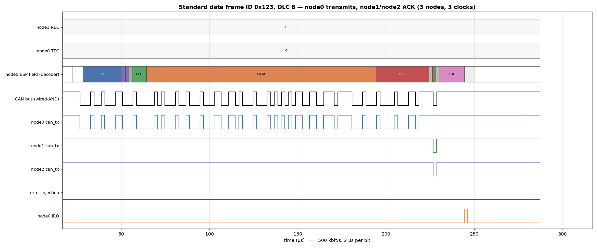
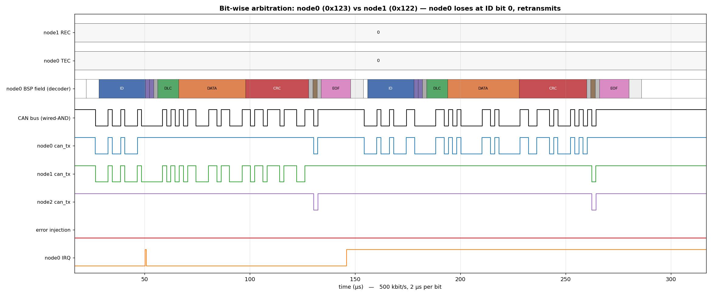
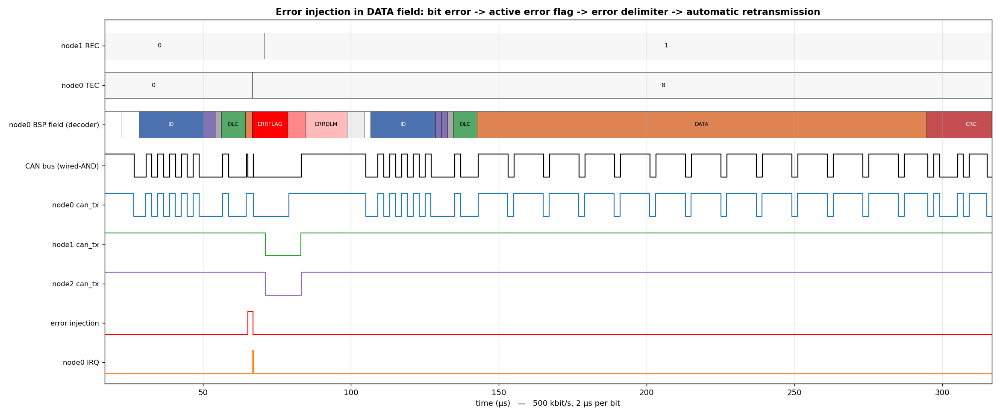

<details>
<summary><b>GTKWave view of the arbitration test</b></summary>

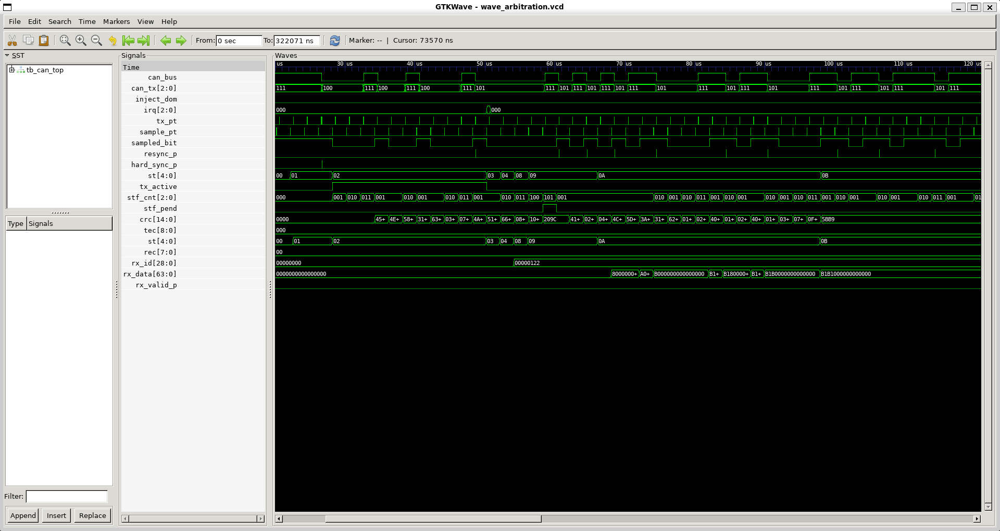
</details>

A Python golden model independently decodes every bus bit, re-encodes each frame and compares the stuff bits, CRC, delimiters, ACK and EOF **bit-exactly** against the RTL.

### UVM 1.2 environment (Vivado xsim)

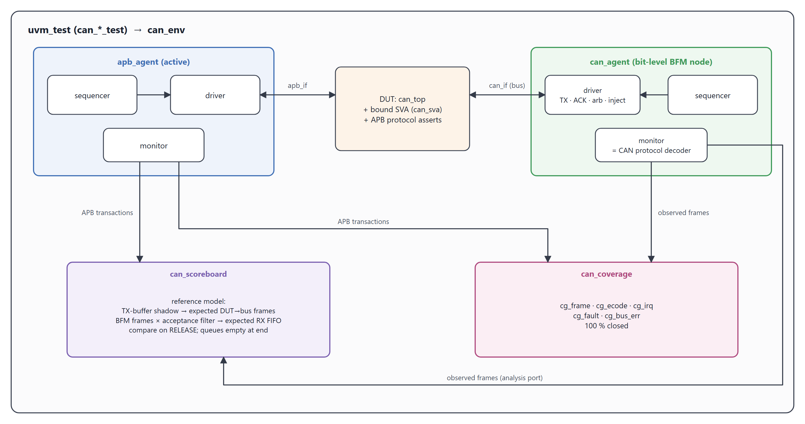

| Component | Role |
|---|---|
| `apb_agent` | Sequencer, driver and monitor for register access |
| `can_agent` | Bit-level **BFM node**: transmits stuffed frames with CRC, joins arbitration, ACKs, injects errors; its monitor is an independent CAN protocol decoder |
| `can_scoreboard` | Reference model: TX-buffer shadow → expected bus frames; BFM frames × acceptance filter → expected RX FIFO contents |
| `can_coverage` | `cg_frame`, `cg_ecode`, `cg_irq`, `cg_fault`, `cg_bus_err` — **100 % closed** |
| `can_sva` (bound) | TX changes only at tx point, silent modes never dominant, no 6 equal bits sent in the stuffed region, TEC/REC consistency, APB protocol |

Tests: `can_reg_test`, `can_dut_tx_test`, `can_dut_rx_test`, `can_arb_test`, `can_err_test`, `can_busoff_test`, `can_full_test`.

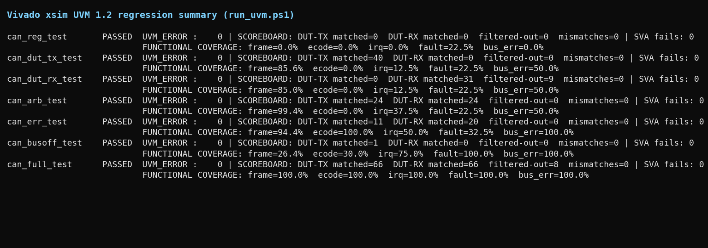
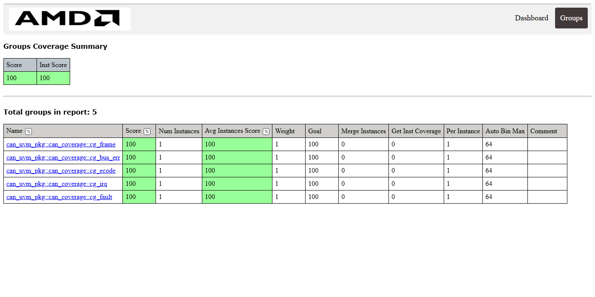

### Theory checked against measurement

| Quantity | Theory | Measured |
|---|---|---|
| Bit time (500 kbit/s) | 2000 ns | 2000.0 ns |
| Sample point | 80 % | 80.0 % |
| CRC-15, 1–5-bit errors | 100 % detected (Hamming distance 6) | 100 % (20 000 trials each) |
| Worst-case stuffed length | ≤ 8n + 47 + ⌊(34+8n−1)/4⌋ | never exceeded |
| Oscillator tolerance | ≤ 0.78 % (ISO formula) | works up to ±1.0 %, fails from ±1.5 % |
| Bus-off threshold | 32 TX errors (TEC > 255) | exactly 32 |
| Bus-off recovery | 128 × 11 bits = 2.816 ms | 2.841 ms |

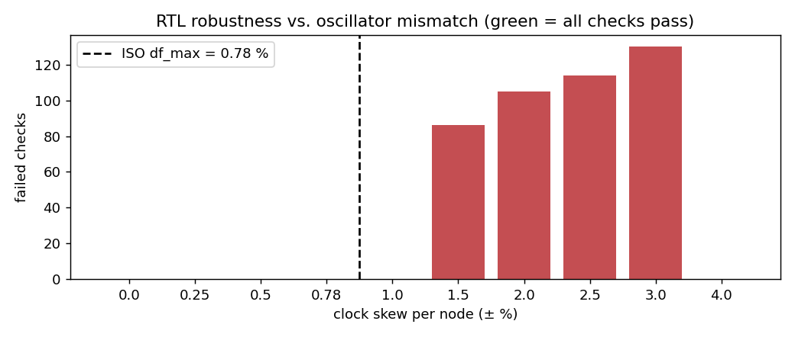

---

## Implementation

### FPGA — Xilinx Artix-7 (Basys-3)
The demo top has two controllers on an internal bus. Each is driven by a small hardware APB "host" state machine:
- **Node A** sends a frame every 5 ms, using the switches as the ID.
- **Node B** shows the received data and ID on the LEDs.
- PMOD **JA1/JA2** carry CAN TX/RX for an external transceiver (e.g. SN65HVD230).

| Build | LUT | FF | Timing | Power |
|---|---|---|---|---|
| IP, out-of-context | 1131 | 492 | Fmax ≈ 119 MHz | — |
| 2-node demo @ 100 MHz | 1189 | 656 | WNS +0.255 ns, WHS +0.086 ns | 82 mW |

| Timing summary (STA) | Power report |
|---|---|
| 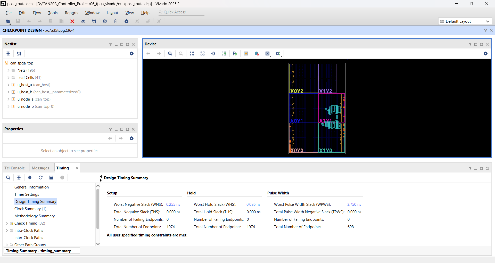 | 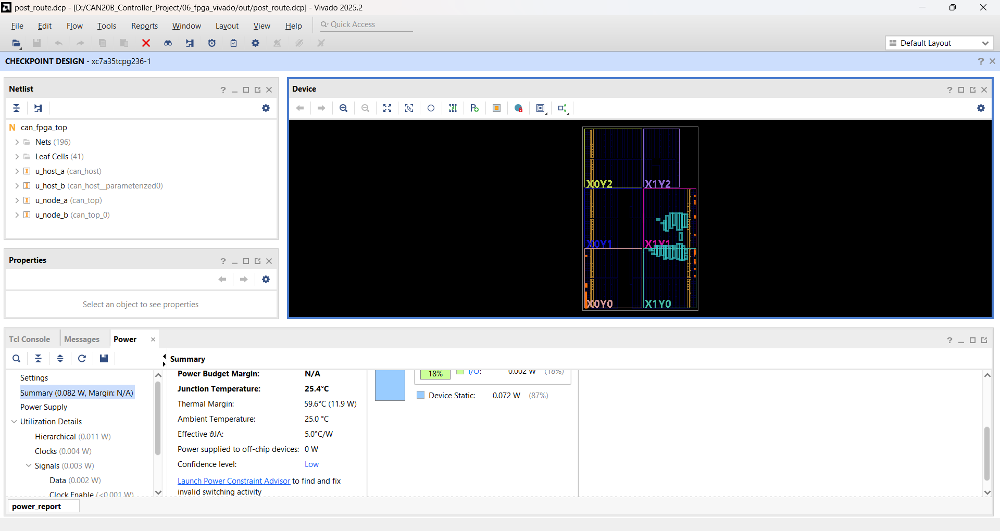 |

### ASIC — SkyWater sky130A (OpenLane)

| Metric | Value |
|---|---|
| Clock | 50 MHz |
| Cells / flip-flops | 4427 / 889 |
| Die area | 0.158 mm² (core utilisation 36 %) |
| Setup / hold slack | +8.38 ns / +0.31 ns (typical); ≥ +4.90 / +0.10 ns across corners |
| Power | 9.94 mW (typical) |
| IR drop | 11.4 mV (0.63 %) |
| Signoff | Magic DRC 0 · Netgen LVS clean · antenna 0 |

| Full chip (GDS) | Standard cells (zoom) |
|---|---|
| 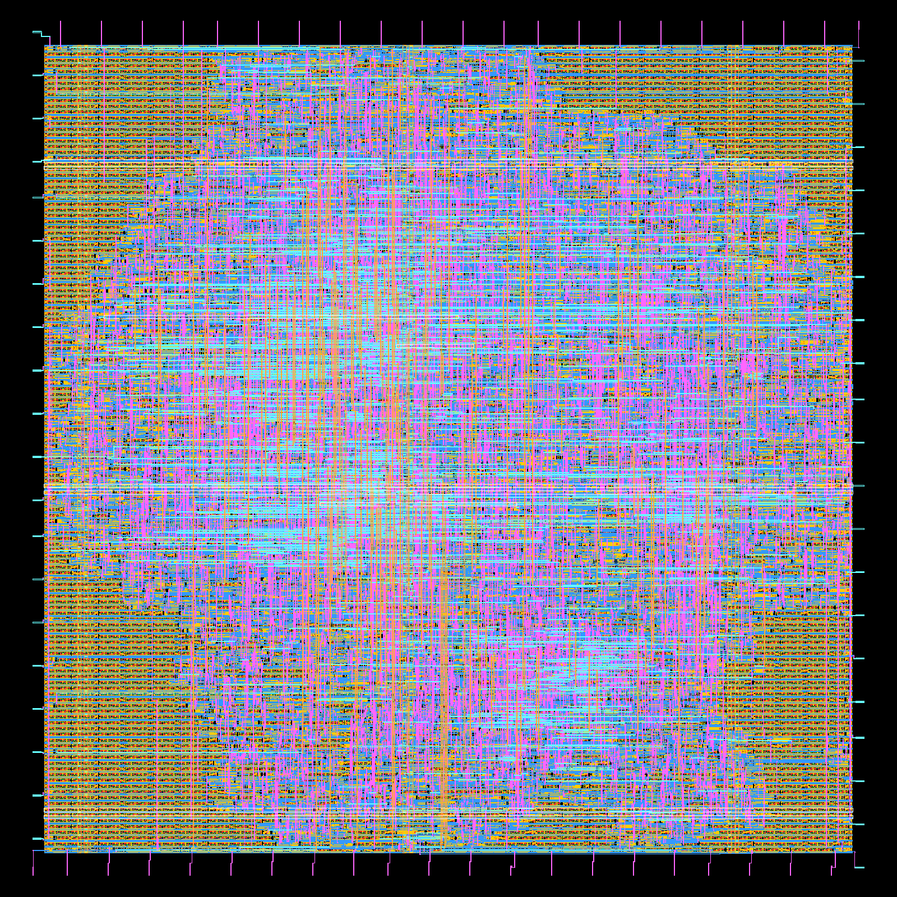 | 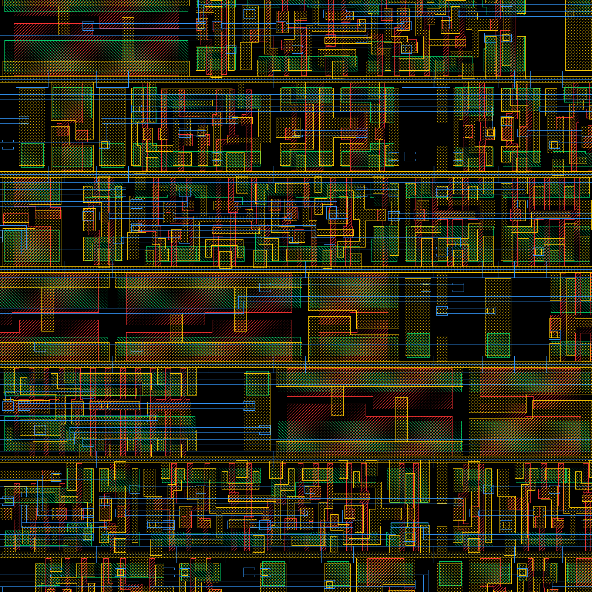 |

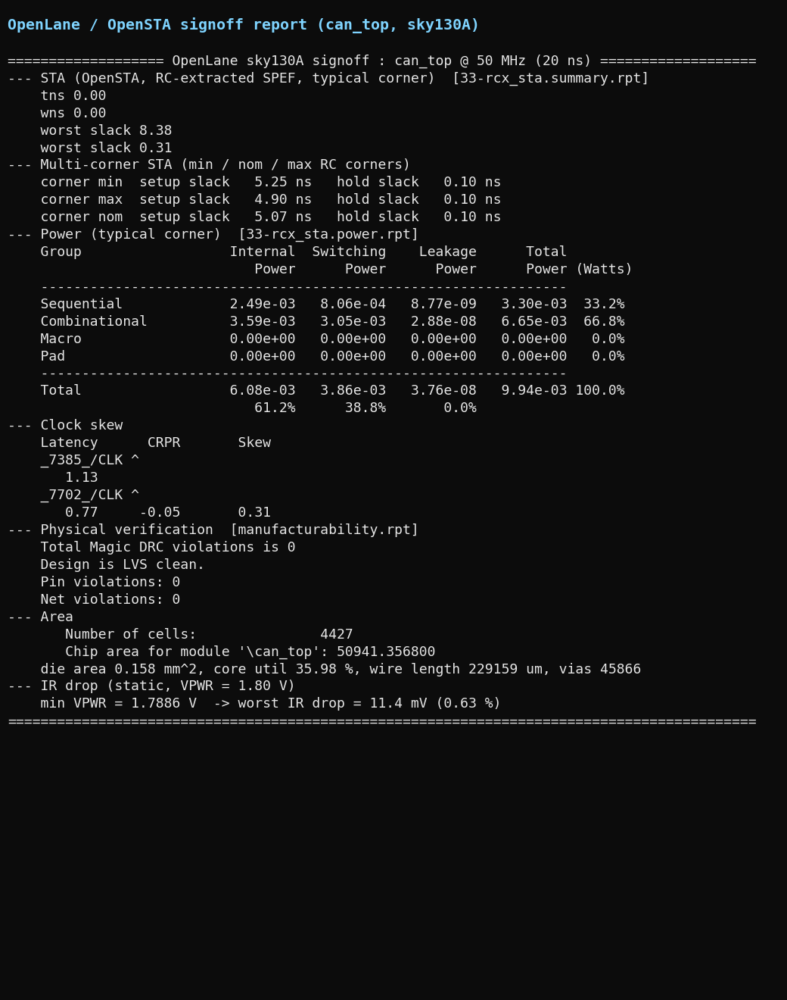
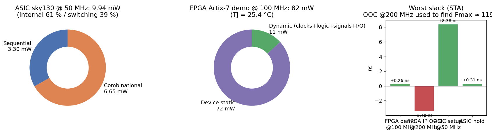

### Firmware — FreeRTOS on the real RTL

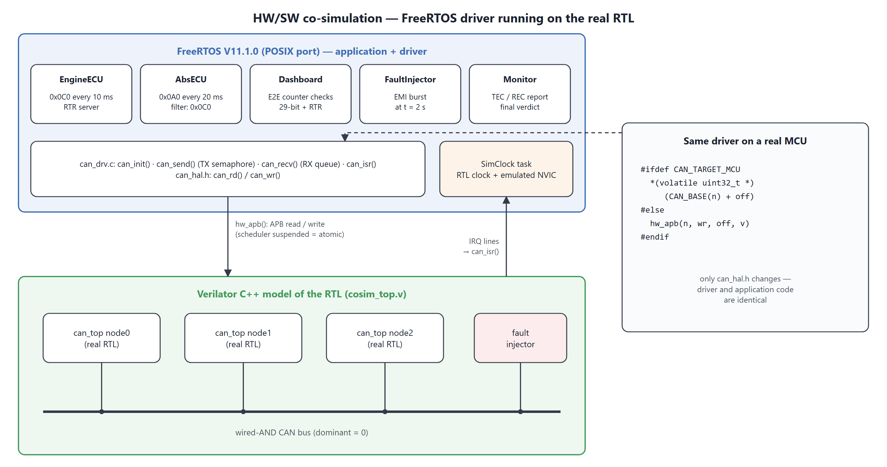
Verilator compiles three controller instances into a C++ model that acts as the "silicon". The FreeRTOS application talks to it only through the register-level driver.

**Driver (`drv/`)**
- `can_init()`, `can_send()` (TX semaphore), `can_recv()` (RX queue) and `can_isr()` (deferred interrupt processing).
- Only `can_hal.h` is target-specific: memory-mapped `volatile` access on an MCU, or APB calls into the RTL model in simulation.

**Application tasks (125 kbit/s)**
- **EngineECU**: sends 0x0C0 every 10 ms and answers remote frames.
- **AbsECU**: sends 0x0A0 every 20 ms; its hardware filter accepts only engine frames.
- **Dashboard**: checks end-to-end rolling counters and sends 29-bit and remote frames.
- **FaultInjector**: creates an EMI burst at t = 2 s.
- **Monitor**: reports error counters and states.
- **SimClock**: steps the RTL clock and acts as the interrupt controller.

**Result:** 501 + 251 periodic frames delivered with **0 lost and 0 duplicated**, and all 20 remote requests answered. The 8 injected glitches caused bit/stuff errors that were all retransmitted, and every node returned to error-active. RTL line coverage from this run is 82 %.

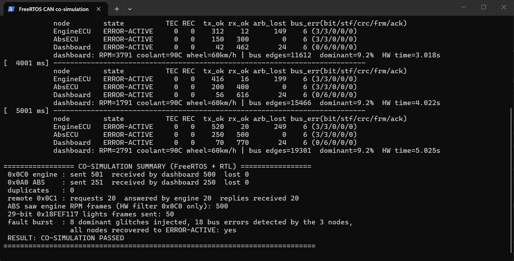

**Schedulability:** worst-case response times range from 2.2 to 4.3 ms against 10–250 ms deadlines, with 17.6 % bus utilisation.

---

## Getting started

### Requirements
| Tool | Used for |
|---|---|
| Icarus Verilog 11+, GTKWave | directed simulation, waveforms |
| Verilator 4.x+ | lint, FreeRTOS co-simulation |
| Python 3 (matplotlib) | golden model, plots |
| Vivado 2020.2+ (tested 2025.2) | UVM 1.2 on xsim, FPGA build |
| OpenLane v1 + sky130A PDK (Docker) | RTL-to-GDS |
| Yosys, KLayout (`pip install klayout`) | synthesis statistics, layout rendering |
| gcc / g++ / make (Linux or WSL) | FreeRTOS co-simulation |

### Run

```bash
# lint
bash 02_lint/run_lint.sh

# directed regression (16 tests) and VCDs for GTKWave
bash 03_tb_directed/run_tests.sh
bash 03_tb_directed/run_waves.sh
gtkwave 03_tb_directed/waves/wave_std_frame.vcd

# golden-model bit-exact cross-check (after the directed run)
python3 05_golden_model/check_bitstream.py

# oscillator-tolerance sweep
bash 03_tb_directed/sweep_tolerance.sh

# RTL -> GDS (edit paths in the script for your OpenLane install)
bash 07_asic_openlane/run_openlane.sh

# FreeRTOS + RTL co-simulation (downloads FreeRTOS-Kernel V11.1.0 first)
cd 08_freertos_cosim && bash get_freertos.sh && make run
make coverage EXTRA=-DTICK_HZ=100      # RTL line coverage of the system run
```

```powershell
# UVM regression on Vivado xsim (Windows); edit $VIV in the script for your install
powershell -ExecutionPolicy Bypass -File 04_uvm\run_uvm.ps1
powershell -ExecutionPolicy Bypass -File 04_uvm\run_uvm.ps1 -Tests can_arb_test -NoCompile

# FPGA build: synthesis, implementation, reports, bitstream
vivado -mode batch -source 06_fpga_vivado/build.tcl
```

### Using the IP in your design
1. Instantiate `can_top` (parameter `RX_FIFO_DEPTH`, default 4) on your APB bus and connect `can_tx`/`can_rx` to a CAN transceiver.
2. Write `CTRL = 1` (reset mode), then program `BTR`, `ACR`/`AMR` and `IRQ_EN`.
3. Write `CTRL = 0`; the controller joins the bus after 11 recessive bits.
4. To transmit:
   1. wait for `STATUS.TX_BUF_FREE`
   2. write `TX_ID`, `TX_DLC` and `TX_DATA0/1`
   3. write `CMD = TX_REQ`
5. To receive: on `IRQ_STAT.RX`, read `RX_ID`, `RX_DLC` and `RX_DATA0/1`, then write `CMD = RELEASE_RX`.

`08_freertos_cosim/drv/` contains a complete reference driver.

---

## Limitations and roadmap
- CAN FD is not supported. Missing features include the second data-phase bit rate, transmitter delay compensation, 64-byte payloads and CRC-17/21.
- There is a single TX buffer. Multiple prioritised mailboxes would avoid priority inversion.
- Triple sampling and formal proofs (SymbiYosys) of the stuffing and arbitration properties are not done yet.
- The BSP next-state logic is single-cycle; pipelining it would raise the FPGA Fmax.
- The FPGA demo is verified in simulation and implementation only; it has not been tested on real hardware with transceivers.

## Acknowledgements
- [FreeRTOS-Kernel](https://github.com/FreeRTOS/FreeRTOS-Kernel) (MIT), fetched by `get_freertos.sh`
- [OpenLane](https://github.com/The-OpenROAD-Project/OpenLane) and the [SkyWater sky130 PDK](https://github.com/google/skywater-pdk)
- Protocol reference: ISO 11898-1 / Bosch CAN Specification 2.0
